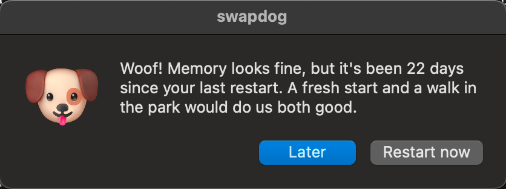

# swapdog 🐶

*A good boy that watches your Mac's memory so you don't have to.*



You know who you are. 47 Chrome tabs, three half-written documents, a terminal with something running that you're "definitely getting back to", and an uptime measured in lunar cycles. You haven't restarted since the last OS update forced you to, and you resent it.

Your Mac has been quietly filling up its swap file. First the spinning beach ball drops by for a visit. Then it moves in. Then one day macOS informs you that *your system has run out of application memory* and asks which app you'd like to sacrifice.

swapdog keeps an eye on it. When something's off, it barks. It's a good dog, not an annoying one.

## What it sniffs

Every 10 minutes, swapdog checks two things.

### Memory pressure

The same green / yellow / red traffic light you see in Activity Monitor. The size of your swap file doesn't matter much: what matters is whether your Mac is struggling *right now*.

While the light is yellow or red, swapdog fills a bucket by 10 minutes per check. While it's green, the bucket drains at the same pace, so a short spike doesn't erase an afternoon of suffering. Once the bucket holds **1 hour**, a dog shows up in the middle of your screen asking you to close a few things or restart. Once a day, tops.

It only counts time your Mac is awake, so working in 20-minute bursts still adds up (nice try).

### Days since your last restart

Even when memory looks fine, after **14 days** without a restart swapdog will gently suggest a fresh start and a walk in the park. If you say **Later**, it asks again a week later. It never does this while memory is struggling, or on a day it already barked about memory.

### What you can answer

**Later** (it'll be back) or **Restart now** (it'll be so proud of you). Either way, restarting resets everything (good human 🦴).

## Install

```sh
git clone https://github.com/tlifschitz/swapdog.git
cd swapdog
./install.sh
```

That puts the script in `~/.local/bin/swapdog`, its face in `~/.local/share/swapdog/`, its notes in `~/.local/state/swapdog/` and a LaunchAgent in `~/Library/LaunchAgents/`.

The first time you click **Restart now**, macOS asks whether swapdog may control **System Events**. Say yes: that's how it politely asks your Mac to restart, giving your apps a chance to save your work.

### Check what it's thinking

```sh
cat ~/.local/state/swapdog/state
```

`acc` is how full the memory-pressure bucket is, in seconds.

## Uninstall

```sh
./uninstall.sh
```

Then restart. Not for swapdog, it's gone. For you.

## Tweaking

Edit `EnvironmentVariables` in `com.github.tlifschitz.swapdog.plist` and run `./install.sh` again:

| Variable | Default | What it means |
|---|---|---|
| `SWAPDOG_PRESSURE_LIMIT_MIN` | `60` | Minutes of yellow or red before it barks |
| `SWAPDOG_UPTIME_DAYS` | `14` | Days without a restart before it suggests one |
| `SWAPDOG_UPTIME_REPEAT_DAYS` | `7` | Days between uptime reminders if you say Later |

## Tests

```sh
bash tests/run_tests.sh
```

`sysctl`, `date` and `osascript` are faked, so the tests don't care how many tabs you have open right now. They also run on every push in CI on macOS.

## Credits

The dog is 🐶 from [Noto Emoji](https://github.com/googlefonts/noto-emoji) by Google, used under the [SIL Open Font License 1.1](LICENSE-noto-emoji). Everything else is [MIT](LICENSE).
